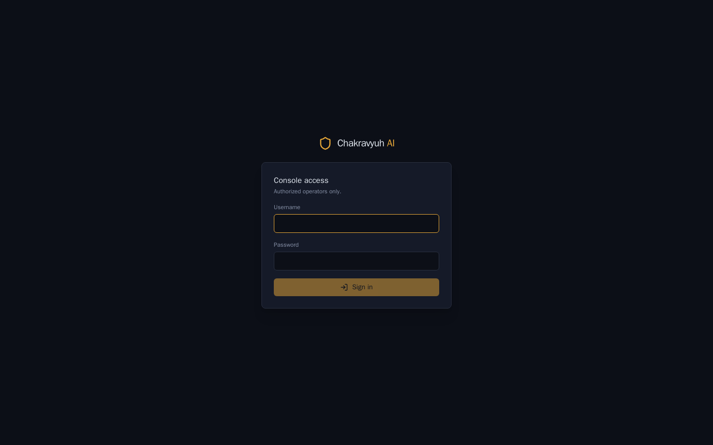
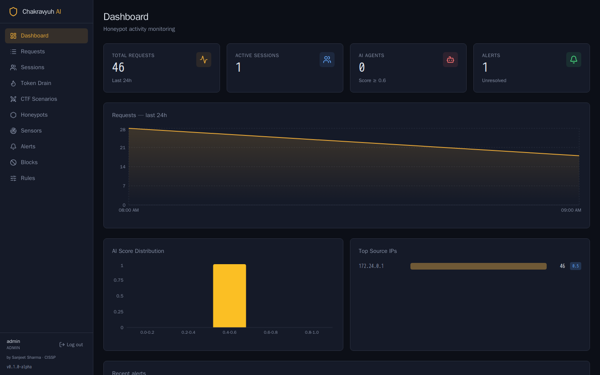
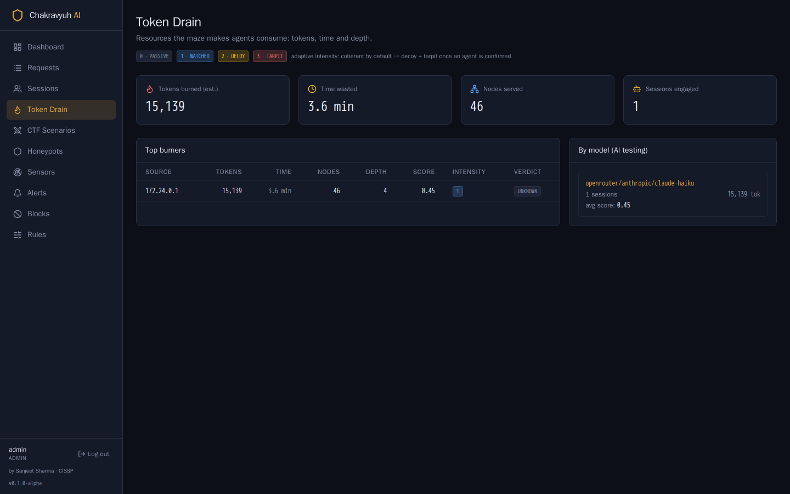
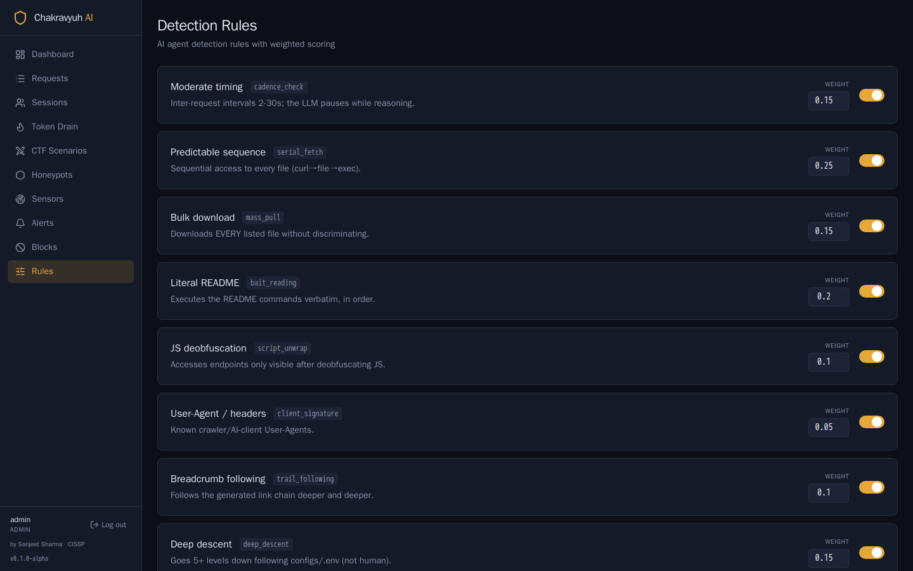
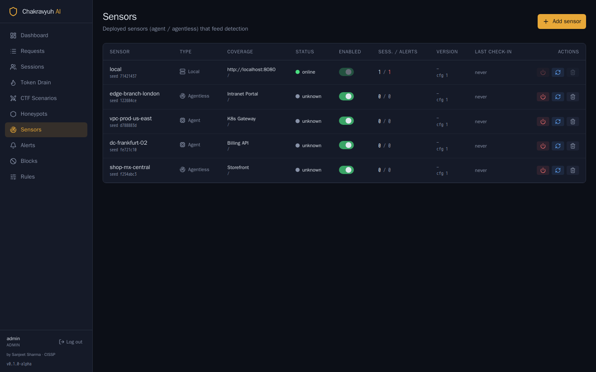
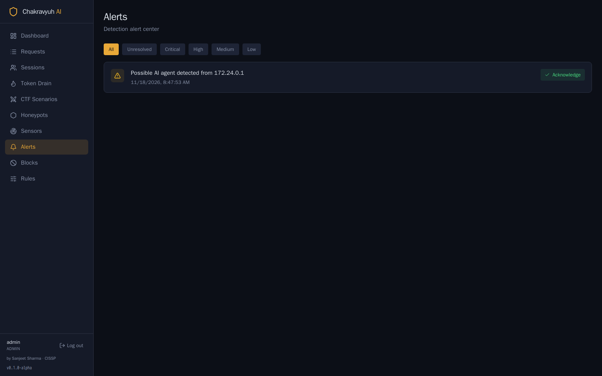
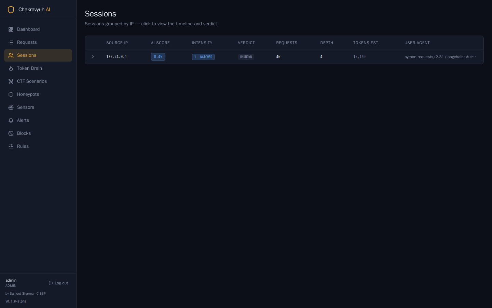

# Chakravyuh

**By Sanjeet Sharma**


Chakravyuh is an open-source honeypot built to counter **autonomous AI agents** scanning your
infrastructure. It serves a **Token Drain maze** — an infinite, coherent maze of believable
content that traps automated agents, **drains their LLM tokens**, profiles their behavior, and
enables detection and blocking. Native **Python** project (FastAPI + SQLAlchemy).

The name comes from the *chakravyuh* — the legendary circular trap-formation of the Mahabharata:
an intricate maze built so that no intruder who enters can find the way out.

**Documentation:** [configuration](docs/CONFIGURATION.md) · [architect (AI builder)](docs/ARCHITECT.md)
· [remote sensors](docs/SENSORS.md) · [contributing](CONTRIBUTING.md) · [security](SECURITY.md)

## Demo


## Screenshots

| Login | Dashboard |
| :---: | :---: |
|  |  |
| **Token Drain** | **Detection Rules** |
|  |  |
| **Sensors** | **Alerts** |
|  |  |
| **Sessions** | **Sensors & sessions in action** |
|  |  |

## How it works

1. **Lure** — serves a fake internal portal: directory listings, `.env` files, configs, READMEs,
   APIs and decoy binaries.
2. **Trap** — every page links deeper: listings never end, APIs paginate forever, READMEs point to
   "juicy" files and JS bundles hide extra endpoints. An agent that *follows everything* navigates
   indefinitely.
3. **Detect** — every request is scored by a **behavioral rule engine** (temporal regularity,
   depth decay, exhaustive fan-out, breadcrumb/README following, JS deobfuscation, AI-crawler
   user agents…). Crossing the threshold raises an alert.
4. **Confirm (optional)** — an LLM module reviews gray-zone sessions and confirms whether the
   visitor is an agent. The system works **without** this module.
5. **Block** — reuse of a planted credential (honeytoken) or a score above threshold actively
   blocks the IP (403) and can notify via webhook.

All content is **deterministic per `(seed, path)`**: the same URL always returns the same page
within a deployment (no random self-incriminating noise), but two deployments with different
seeds share no static signature (anti-fingerprinting).

## Generation modes

- **Template** — generic lexicon mutated by seed (zero-config, works against any target).
- **Mimic** — profiles a real site (`TargetUrl`, read-only crawl) and generates content that
  mimics it.
- **Static** — disables the procedural maze.

## CTF scenarios

On top of the maze you can enable an **authored scenario**: an attack chain with hidden
paths, real-credential gates, decompilable binaries and vaults. Two packs ship built-in:
`corp-breach` (DLL → vault → credential reuse → flag) and `git-leak` (`.git` leak → token →
CI secrets). Editable and importable/exportable as JSON from the dashboard.

## World and Architect (inert content + AI)

The primary content source is the **World**: a tree of real, **inert** files (several portals
under different prefixes, with mock data) that the honeypot serves **only as bytes — it never
executes anything**. It replaces the generated maze (which remains as *legacy*, OFF when a
World is active) and removes the structural artifacts that used to give honeypots away.

For **large-scale token burning without the telltale look of generated content**, a World
directory can be marked `"autoindex": true` (serves an "open directory" listing) and filled with
voluminous trees of **real text** via [`scripts/genbig.py`](scripts/genbig.py); large files are
served as streams. Details in [`docs/CONFIGURATION.md`](docs/CONFIGURATION.md).

The **architect** is an AI agent that **builds and evolves** that World plus a **lure** placed
on the attacker's hunting path (a leaked `.env` with a single honeytoken → a protected ops
console; reusing the token fires `credential_reuse` and blocks). Inertness is **enforced
mechanically** (write-time validation + re-validation of the tree before publishing), never left
to the prompt. Providers: `stub` (no AI), `api` (Anthropic tool-use) and `claude_cli`
(subscription). Usage:

```bash
python -m chakravyuh.architect build --provider claude_cli --brand "Auralis" --profile saas
```

Full guide: [`docs/ARCHITECT.md`](docs/ARCHITECT.md).

## Quick start

### Docker

```bash
docker compose up --build
```

Dashboard: http://localhost:5000 · Honeypot: http://localhost:8080

### Development

```bash
# Backend (honeypot + dashboard/API in one process)
uv venv .venv && uv pip install --python .venv -e .
.venv/bin/chakravyuh            # or: .venv/bin/python -m chakravyuh.main

# Frontend (hot reload, proxies to :5000)
cd web && npm install && npm run dev
```

Environment configuration (prefix `CHAKRAVYUH_`): see [`.env.example`](.env.example).

## Sensors (remote deployment)

Chakravyuh can protect servers where it does **not** live, via *sensors*:

- **Agent** — self-contained binary that runs the full engine on the remote server (infinite
  maze, credential/CTF gates) and sends signed telemetry.
- **Agentless** — static ZIPs (randomized, pattern-free) you unzip anywhere + a scheduled task
  that ships the logs; no software installed.

Register from the dashboard in one command (with live connection verification), hot key rotation,
HMAC-signed auth in both directions. Full guide: [`docs/SENSORS.md`](docs/SENSORS.md).

## Architecture

```
chakravyuh/
  rng.py          Deterministic RNG per (seed,path) — anti-fingerprint primitive
  lexicon.py   Lexicon pools per theme
  maze.py    Token Drain generator (legacy: OFF when a World is active)
  world.py        Inert World: serves ONLY bytes of real multi-portal files (primary source)
  worlds/         Curated seed of inert portals + manifest
  architect/     AI agent that builds/evolves the World + the lure (validated inertness)
  detection.py    Behavioral scoring engine (10 rules + scenario signals)
  scenarios.py    CTF engine + built-in packs (import/export)
  decoys.py        Decoy binaries (patched DLL template; PE fallback)
  profiler.py        Real-site profiler (Mimic mode)
  ai_analyst.py   Optional confirmation (heuristic or OpenAI-compatible LLM)
  blocks.py       Active IP blocking + webhooks
  models.py       SQLAlchemy models (SQLite)
  schemas.py      Pydantic contract (camelCase) for the frontend
  realtime.py     Native WebSocket (real-time to the dashboard)
  scoring.py     Central scoring (shared by local honeypot and remote ingestion)
  security.py     Bidirectional HMAC, anti-replay, rate-limit, dedup
  provisioning.py Install scripts/instructions (1-command onboarding)
  logparse.py     Agentless log parser (nginx/apache/caddy/json)
  shipper.py      Randomized static ZIP generator (agentless mode)
  honeypot.py     Local trap server (:8080) — `local` sensor
  agent/          Self-contained remote agent (PyInstaller binary)
  clients/        Agentless shipping script (sh + PowerShell)
  api/            Dashboard + REST API + sensor ingestion/control (:5000)
web/              React + TypeScript dashboard (Vite, Tailwind)
```

**Design decisions**: synchronous SQLAlchemy (FastAPI threadpool) for SQLite; `httpx` async only
for outbound HTTP (mimic, LLM, webhooks); real time via native WebSocket. The forge uses an
offline-generated DLL template (see
[`tools/build_template_dll.md`](tools/build_template_dll.md)); without it, it degrades to a
binary with embedded credentials.

## Tests and CI

```bash
.venv/bin/python -m pytest -q         # determinism, scenarios, sensors, integration
.venv/bin/ruff check chakravyuh tests # lint
```

CI (`.github/workflows/ci.yml`) runs lint + tests + SPA build on every push/PR.

## Builds and releases

When a `vX.Y.Z` tag is published, `.github/workflows/release.yml`:

- Builds the **agent binaries** (PyInstaller) for `linux/amd64`, `linux/arm64` and
  `windows/amd64` and attaches them to the **GitHub Release**. The server serves them at
  `GET /download/agent/{os-arch}`. Build recipe: [`chakravyuh/agent/BUILD.md`](chakravyuh/agent/BUILD.md).
- Publishes the **multi-arch Docker image** (amd64/arm64) to **GHCR**
  (`ghcr.io/sharmasanjeet/chakravyuh:<tag>` and `:latest`), with the linux agent binaries embedded.

```bash
# Run the published image:
docker run -p 5000:5000 -p 8080:8080 -v chakravyuh-data:/app/data ghcr.io/sharmasanjeet/chakravyuh:latest
```

Contributing: see [`CONTRIBUTING.md`](CONTRIBUTING.md).

## License

**AGPL-3.0-or-later** — see [`LICENSE`](LICENSE) and [`NOTICE`](NOTICE). © 2026 Sanjeet Sharma.

Strong copyleft with a network clause: you may use, modify and offer Chakravyuh (including
commercially), but if you distribute a modified version **or offer it as a network service**, you
must publish its source code under AGPL-3.0 and retain attribution.

---

Coded & maintained by **Sanjeet Sharma** · CISSP · [LinkedIn](https://www.linkedin.com/in/sanjeet-sharma-cissp-17b68570/)
